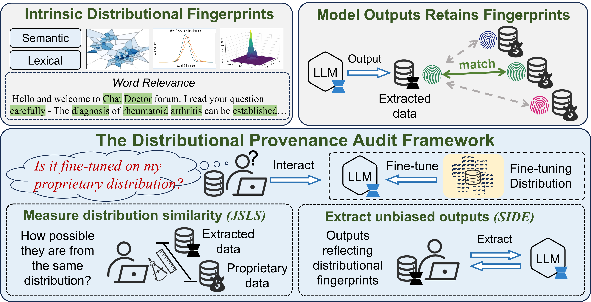

# Dataset Distribution Identification

This is the official code repository for paper **Auditing Data Provenance in LLM Fine-tuning via Intrinsic Distributional Fingerprints**. 

In this paper, we propose Distribution Provenance Audit (DPA), a novel framework that enhances data management through unauthorized data usage detection and data privacy leakage assessment. Given the high value of proprietary LLM fine-tuning data and potential infringement risks, DPA plays a critical role in data curation and security for the LLM era, focusing on data provenance and infringement detection while complementing prior works with greater effectiveness and robustness. In particular, Section 6 details DPA's applications to fine-tuning data provenance and the tension between AI transparency and privacy leakage, and Section 7 evaluates DPA's effectiveness, robustness, and reliability for LLM data management.

The paper is now under review of CCS'26 Round-1. More organized codes will be released after the paper is accepted.



## Environment Setup

### 1. Create Conda Environment

To replicate the environment, follow these steps:

#### Step 1: Create a new conda environment and activate it

```sh
> conda create -n DPA python=3.10.16 -y

> conda activate DPA
```

#### 2. Install Dependencies

```
> pip install -r requirements.txt
```

In particular, our experiments are carried out on an A100 GPU with ` CUDA Version: 12.4` and `torch==2.7.0`. You may need to specifically install `torch` according to your devices. 

## 2. Install Datasets and Models

DPA can be applied to any datasets and base models. For reproducing the experiments mentioned in the original paper, we detail the datasets and models used in our experiments.

### Datasets:

- MedAlpaca: [wikidoc](https://huggingface.co/datasets/medalpaca/medical_meadow_wikidoc), [flashcards](https://huggingface.co/datasets/medalpaca/medical_meadow_medical_flashcards)
- ChatDoctor: [HCM](https://huggingface.co/datasets/xDAN-datasets/ChatDoctor_HealthCareMagic_112k), [GPT](https://huggingface.co/datasets/xDAN-datasets/ChatDoctor_chatdoctor_7k)
- CaseLaw: [Del](https://huggingface.co/datasets/free-law/Caselaw_Access_Project/tree/main/delaware), [Ariz](https://huggingface.co/datasets/free-law/Caselaw_Access_Project/tree/main/arizona)

The paraphrased datasets mentioned in the paper are proposed in the repo. They technically paraphrased with [DeepSeek](https://chat.deepseek.com/) API. For reproduction, the data can be found in:

- MedAlpaca: [wikidoc-para](./intermediate_data/datasets/medalpaca/aggregated_paraphrased_dataset_medalpaca.json)
- ChatDoctor: [HCM-para](./intermediate_data/datasets/chatdoctor/aggregated_paraphrased_dataset_chatdoctor.json)
- CaseLaw: [Del-para](./intermediate_data/datasets/caselaw/aggregated_paraphrased_dataset_caselaw_delaware.json)

### Models:

- Base Models: [Pythia-2.8b](https://huggingface.co/EleutherAI/pythia-2.8b), [Qwen3-4B-Instruct](https://huggingface.co/Qwen/Qwen3-4B-Instruct-2507), [Llama3-8B-Instruct](https://huggingface.co/unsloth/Meta-Llama-3.1-8B-Instruct-bnb-4bit)

- Encoder & Decoder used in SIDE:
    - Encoder: [sentence-transformer](https://huggingface.co/sentence-transformers/gtr-t5-base)
    - Decoder: (`pip install vec2text`) [gtr__nq__32](https://huggingface.co/jxm/gtr__nq__32) and [gtr__nq__32__correct](https://huggingface.co/jxm/gtr__nq__32__correct)

## Evaluation Details

### Fine-tuning models

```py
# For the Q&A mode:
python ./fine-tuning/ft_qa.py --...
```

```py
# For the completion mode:
python ./fine-tuning/ft_complete.py --...
```

### Measure distributions via JSLS

```py
python ./DPA/jsls.py --...
```

### Extract outputs via SIDE

```py
# For the Q&A mode:
python ./DPA/side/side_qa.py --...
```

```py
# For the Q&A mode:
python ./DPA/side/side_complete.py --...
```

